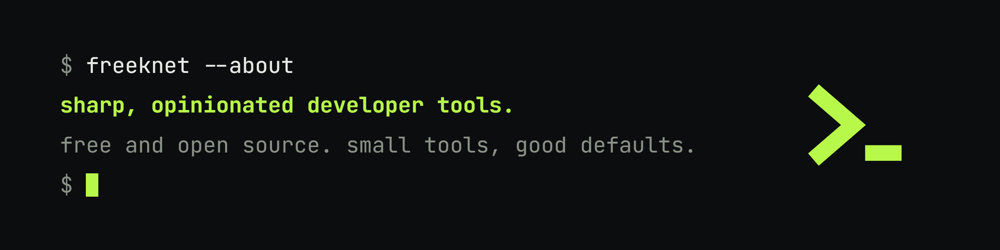

### Sharp, opinionated developer tools. Free and open source.

Small tools that do one job well, ship with sensible defaults, and stay out of your way.

<!-- GEN:stats:START - generated by .github/workflows/update-readme.yml, do not edit by hand -->

<a href="https://github.com/orgs/freeknet/repositories?type=source"><b>10</b> projects</a> &nbsp;·&nbsp; <a href="https://github.com/orgs/freeknet/repositories?type=fork"><b>2</b> forks</a> &nbsp;·&nbsp; <b>3</b> stars &nbsp;·&nbsp; written in Rust, TypeScript and C++

<!-- GEN:stats:END -->

[Projects](#projects) · [Forks](#forks) · [What we care about](#what-we-care-about) · [Get involved](#get-involved)

## Projects

<!-- GEN:projects:START - generated from scripts/readme.config.json, do not edit by hand -->
### Desktop apps

Native apps and plug-ins, mostly written in Rust.

| Project | What it does | Stack |
| --- | --- | --- |
| [**aivideoeditor**](https://github.com/freeknet/aivideoeditor) <a href="https://github.com/freeknet/aivideoeditor/releases/tag/v0.1.0">v0.1.0</a> | AI video editor: index footage, plan beat-synced edits, render and export timelines. | Rust MIT |
| [**rustaman**](https://github.com/freeknet/rustaman) <a href="https://github.com/freeknet/rustaman/releases/tag/v0.2.0">v0.2.0</a> · ★ 1 | A modern, responsive Windows task manager written in Rust. | Rust MIT |
| [**rustdirstat**](https://github.com/freeknet/rustdirstat) <a href="https://github.com/freeknet/rustdirstat/releases/tag/v0.2.2">v0.2.2</a> · ★ 1 | A cross-platform WinDirStat clone written in Rust, with both a native desktop GUI and a terminal UI. | Rust · Nix MIT |
| [**juce-plugin-example**](https://github.com/freeknet/juce-plugin-example) | LumaScope: a production-minded JUCE 8 spectrum analyzer for Windows, shipped as a VST3 plug-in and standalone app. | C++ · TypeScript · CMake GPL-3.0 |

### Languages & systems

Compilers and the low-level pieces underneath everything else.

| Project | What it does | Stack |
| --- | --- | --- |
| [**cinnabar**](https://github.com/freeknet/cinnabar) | A zero-trust systems language with linear types, compiled to native code through LLVM. Probably better than Rust. | Rust · TypeScript · C Apache-2.0 |

### Self-hosted on Cloudflare

Personal apps you deploy to your own Cloudflare account.

| Project | What it does | Stack |
| --- | --- | --- |
| [**agentic-drive**](https://github.com/freeknet/agentic-drive) | Personal cloud drive on Cloudflare Workers and R2: folders, resumable uploads, share links, Mail integration and an installable PWA. | TypeScript · Node |
| [**agentic-inbox**](https://github.com/freeknet/agentic-inbox) | Single-user webmail on Cloudflare Workers: Resend delivery, Durable Object storage, an AI drafting agent, an MCP server and an installable PWA. | TypeScript · Node Apache-2.0 |

### Developer tooling

Scaffolds, templates and libraries for starting projects right.

| Project | What it does | Stack |
| --- | --- | --- |
| [**next-site-template**](https://github.com/freeknet/next-site-template) | Statically exported Next.js 16 site template: contrast-checked light and dark palette, markdown content and build-time social cards. | TypeScript · Node MIT |
| [**create-rust-app**](https://github.com/freeknet/create-rust-app) | Scaffold Rust projects (CLI, GUI, TUI, lib, workspace) with strict lints, CI and release automation, in a very colourful terminal. | Rust · TypeScript · Node MIT |
| [**metaplate**](https://github.com/freeknet/metaplate) <a href="https://github.com/freeknet/metaplate/releases/tag/v0.9.0">v0.9.0</a> · ★ 1 | Composable, framework-neutral Open Graph image tooling for TypeScript. | TypeScript · Node MIT |
<!-- GEN:projects:END -->

More tools are on the way. Watch this org to see them when they land.

## Forks

Upstream projects we build on, and how far our branch has moved from theirs.

<!-- GEN:forks:START - generated by .github/workflows/update-readme.yml, do not edit by hand -->
| Fork | Upstream | What it is | Our changes |
| --- | --- | --- | --- |
| [**egui-material3**](https://github.com/freeknet/egui-material3) Rust | [nikescar/egui-material3](https://github.com/nikescar/egui-material3) ★ 35 | material3 theme for egui eframe. | Tracking upstream |
| [**RapidRAW**](https://github.com/freeknet/RapidRAW) TypeScript | [CyberTimon/RapidRAW](https://github.com/CyberTimon/RapidRAW) ★ 11.3k | A beautiful, non-destructive, and GPU-accelerated RAW image editor built with performance in mind. | Tracking upstream |
<!-- GEN:forks:END -->

## What we care about

<table>
<tr>
<td width="50%" valign="top">

**Good defaults.** A tool should do the right thing before you configure anything.

</td>
<td width="50%" valign="top">

**Strict by default.** Lints, CI and release automation come set up from day one, so you don't bolt them on later.

</td>
</tr>
<tr>
<td width="50%" valign="top">

**Nice to use.** Clear output, helpful errors, and a terminal that's pleasant to look at.

</td>
<td width="50%" valign="top">

**Open.** Everything here is free and open source. Each project's license is listed under its stack.

</td>
</tr>
</table>

## Get involved

- Found a bug or have an idea? Open an issue on the project's repo.
- Pull requests are welcome. For anything large, start with an issue so we can talk it through.
- If a tool saves you time, a ⭐ helps other people find it.
