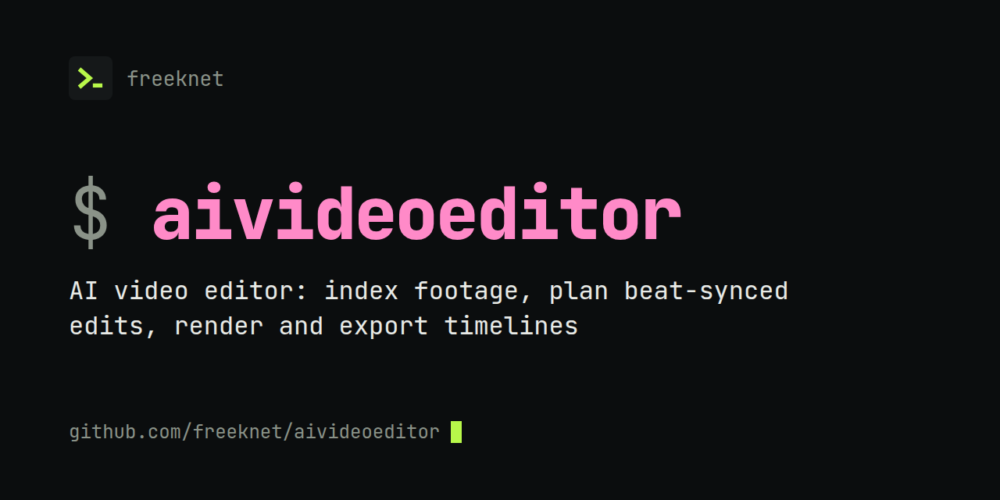
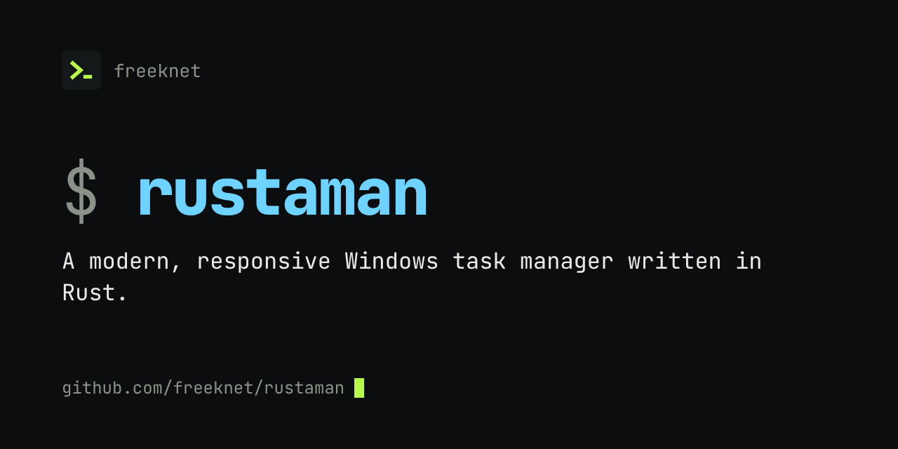
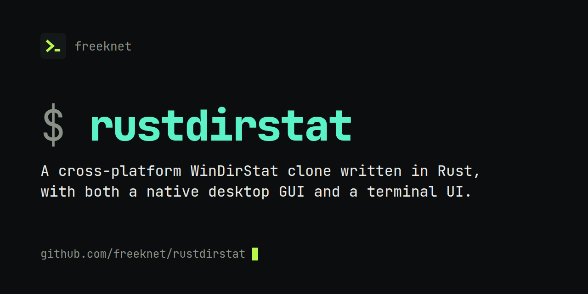
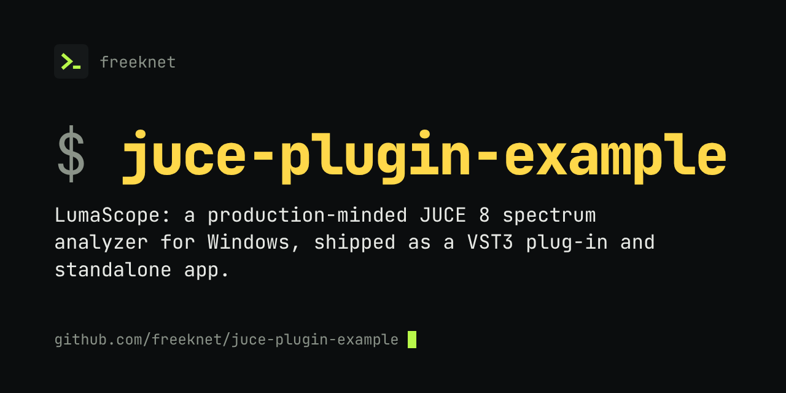
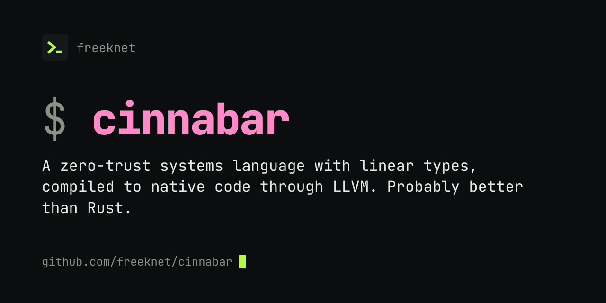
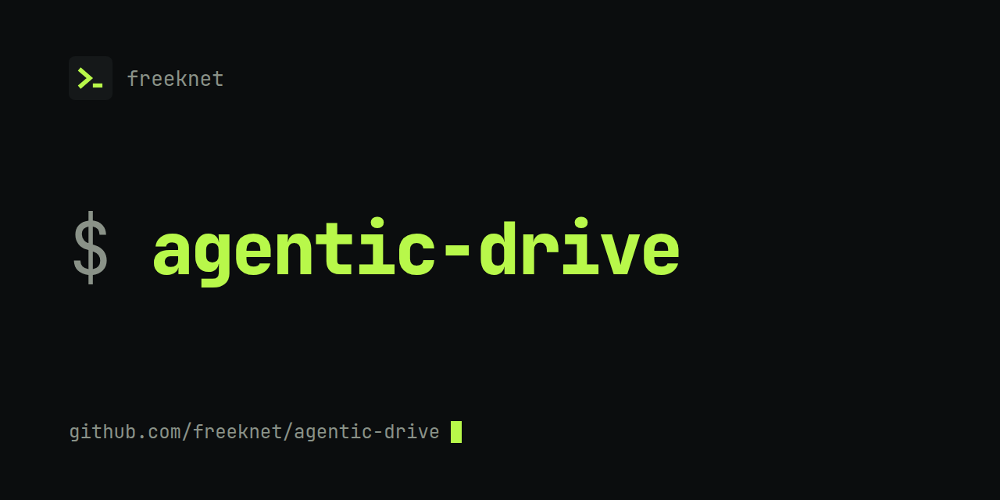
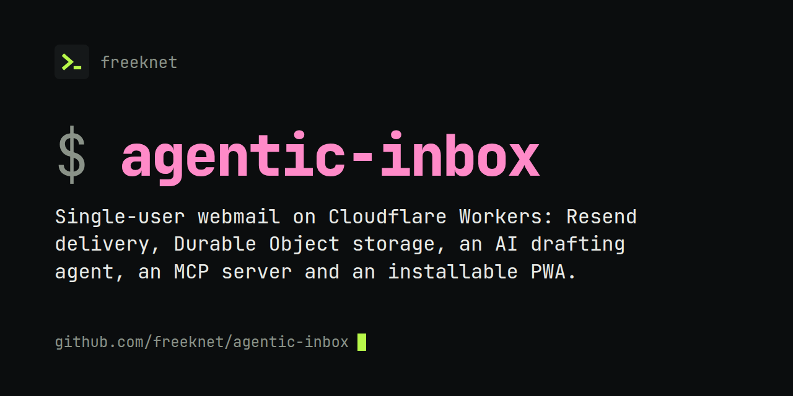
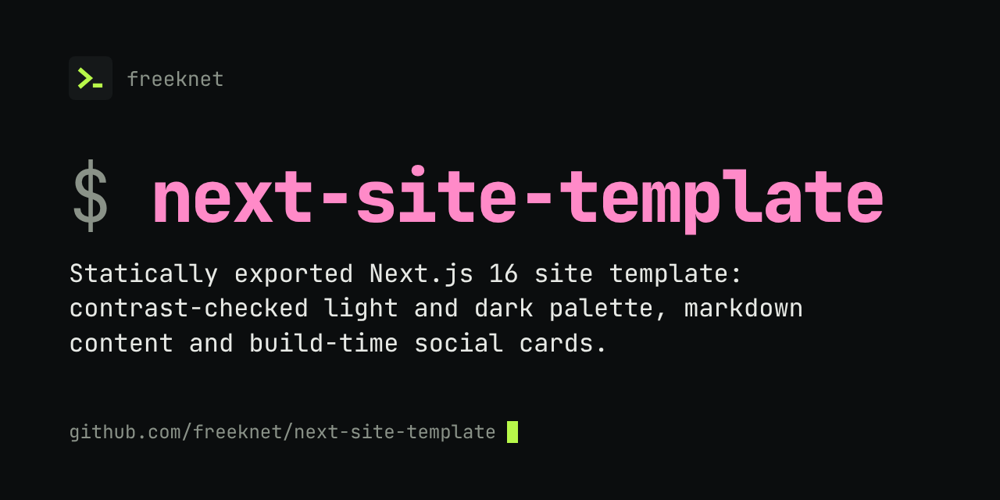
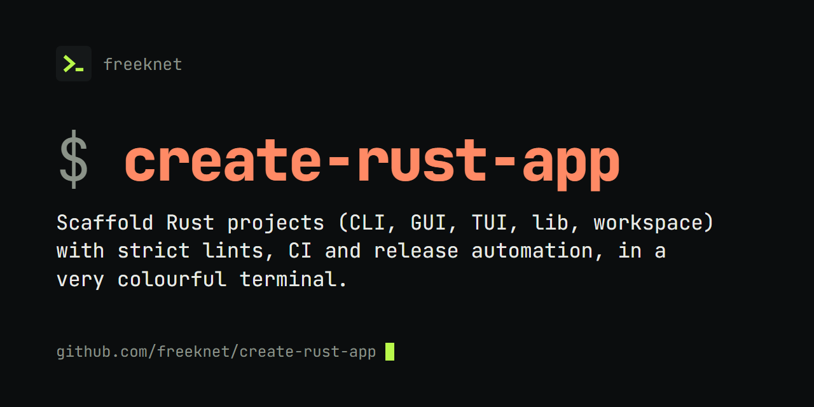
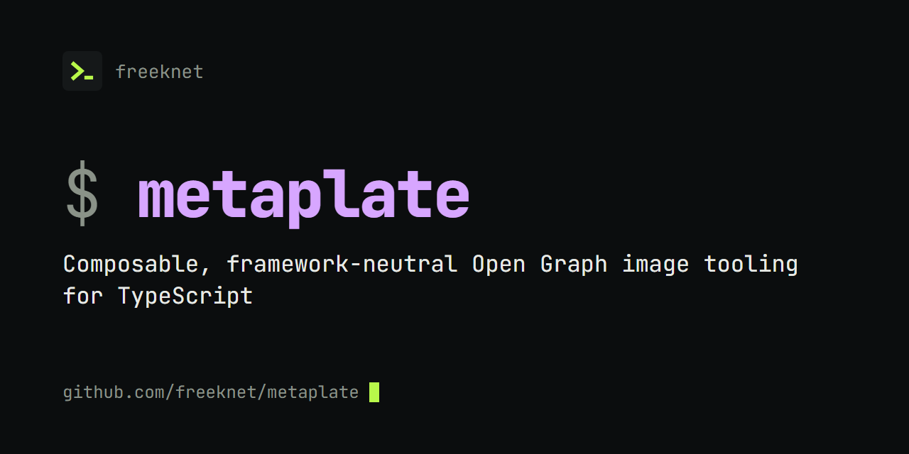

### Sharp, opinionated developer tools. Free and open source.

Small tools that do one job well, ship with sensible defaults, and stay out of your way.

<!-- GEN:stats:START - generated by .github/workflows/update-readme.yml, do not edit by hand -->

<!-- GEN:stats:END -->

[Projects](#projects) · [Forks](#forks) · [What we care about](#what-we-care-about) · [Get involved](#get-involved)

## Projects

<!-- GEN:projects:START - generated from scripts/readme.config.json, do not edit by hand -->
### Desktop apps

Native apps and plug-ins, mostly written in Rust.

<table>
<tr>
<td width="50%" valign="top">

 
<b><a href="https://github.com/freeknet/aivideoeditor">aivideoeditor</a></b> &nbsp;·&nbsp; Rust &nbsp;·&nbsp; MIT &nbsp;·&nbsp; <a href="https://github.com/freeknet/aivideoeditor/releases/tag/v0.1.0">v0.1.0</a>
</td>
<td width="50%" valign="top">

 
<b><a href="https://github.com/freeknet/rustaman">rustaman</a></b> &nbsp;·&nbsp; Rust &nbsp;·&nbsp; MIT &nbsp;·&nbsp; ★ 1 &nbsp;·&nbsp; <a href="https://github.com/freeknet/rustaman/releases/tag/v0.2.0">v0.2.0</a>
</td>
</tr>
<tr>
<td width="50%" valign="top">

 
<b><a href="https://github.com/freeknet/rustdirstat">rustdirstat</a></b> &nbsp;·&nbsp; Rust · Nix &nbsp;·&nbsp; MIT &nbsp;·&nbsp; ★ 1 &nbsp;·&nbsp; <a href="https://github.com/freeknet/rustdirstat/releases/tag/v0.2.2">v0.2.2</a>
</td>
<td width="50%" valign="top">

 
<b><a href="https://github.com/freeknet/juce-plugin-example">juce-plugin-example</a></b> &nbsp;·&nbsp; C++ · TypeScript · CMake &nbsp;·&nbsp; GPL-3.0
</td>
</tr>
</table>

### Languages & systems

Compilers and the low-level pieces underneath everything else.

<table>
<tr>
<td width="50%" valign="top">

 
<b><a href="https://github.com/freeknet/cinnabar">cinnabar</a></b> &nbsp;·&nbsp; Rust · TypeScript · C &nbsp;·&nbsp; Apache-2.0
</td>
<td width="50%"></td>
</tr>
</table>

### Self-hosted on Cloudflare

Personal apps you deploy to your own Cloudflare account.

<table>
<tr>
<td width="50%" valign="top">

 
<b><a href="https://github.com/freeknet/agentic-drive">agentic-drive</a></b> &nbsp;·&nbsp; TypeScript
</td>
<td width="50%" valign="top">

 
<b><a href="https://github.com/freeknet/agentic-inbox">agentic-inbox</a></b> &nbsp;·&nbsp; TypeScript · Node &nbsp;·&nbsp; Apache-2.0
</td>
</tr>
</table>

### Developer tooling

Scaffolds, templates and libraries for starting projects right.

<table>
<tr>
<td width="50%" valign="top">

 
<b><a href="https://github.com/freeknet/next-site-template">next-site-template</a></b> &nbsp;·&nbsp; TypeScript · Node &nbsp;·&nbsp; MIT
</td>
<td width="50%" valign="top">

 
<b><a href="https://github.com/freeknet/create-rust-app">create-rust-app</a></b> &nbsp;·&nbsp; Rust · TypeScript · Node &nbsp;·&nbsp; MIT
</td>
</tr>
<tr>
<td width="50%" valign="top">

 
<b><a href="https://github.com/freeknet/metaplate">metaplate</a></b> &nbsp;·&nbsp; TypeScript · Node &nbsp;·&nbsp; MIT &nbsp;·&nbsp; ★ 1 &nbsp;·&nbsp; <a href="https://github.com/freeknet/metaplate/releases/tag/v0.9.0">v0.9.0</a>
</td>
<td width="50%"></td>
</tr>
</table>
<!-- GEN:projects:END -->

More tools are on the way. Watch this org to see them when they land.

## Forks

Upstream projects we build on, and how far our branch has moved from theirs.

<!-- GEN:forks:START - generated by .github/workflows/update-readme.yml, do not edit by hand -->
| Fork | Upstream | What it is | Our changes |
| --- | --- | --- | --- |
| [**egui-material3**](https://github.com/freeknet/egui-material3) Rust | [nikescar/egui-material3](https://github.com/nikescar/egui-material3) ★ 35 | material3 theme for egui eframe. | Tracking upstream |
| [**RapidRAW**](https://github.com/freeknet/RapidRAW) TypeScript | [CyberTimon/RapidRAW](https://github.com/CyberTimon/RapidRAW) ★ 11.3k | A beautiful, non-destructive, and GPU-accelerated RAW image editor built with performance in mind. | Tracking upstream |
<!-- GEN:forks:END -->

## What we care about

<table>
<tr>
<td width="50%" valign="top">

**Good defaults.** A tool should do the right thing before you configure anything.

</td>
<td width="50%" valign="top">

**Strict by default.** Lints, CI and release automation come set up from day one, so you don't bolt them on later.

</td>
</tr>
<tr>
<td width="50%" valign="top">

**Nice to use.** Clear output, helpful errors, and a terminal that's pleasant to look at.

</td>
<td width="50%" valign="top">

**Open.** Everything here is free and open source. Each project's license is on its card.

</td>
</tr>
</table>

## Get involved

- Found a bug or have an idea? Open an issue on the project's repo.
- Pull requests are welcome. For anything large, start with an issue so we can talk it through.
- If a tool saves you time, a ⭐ helps other people find it.
