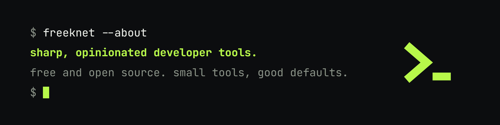

# freeknet

**Sharp, opinionated developer tools. Free and open source.**

Small tools that do one job well, ship with sensible defaults, and stay out of your way.

---

## Projects

<!-- PROJECTS:START - generated by .github/workflows/update-readme.yml, do not edit by hand -->
| Project | What it does | Stack |
| --- | --- | --- |
| [**juce-plugin-example**](https://github.com/freeknet/juce-plugin-example) | A production-minded example project showing how to build a Windows spectrum-analyzer audio product with JUCE 8. | C++ · CMake · TypeScript |
| [**rustdirstat**](https://github.com/freeknet/rustdirstat) | A cross-platform WinDirStat clone written in Rust, with both a native desktop GUI and a terminal UI. | Nix · Rust |
| [**rustaman**](https://github.com/freeknet/rustaman) | A better task manager, written in Rust. | Rust |
| [**metaplate**](https://github.com/freeknet/metaplate) | Composable, framework-neutral Open Graph image tooling for TypeScript. | Node · TypeScript |
| [**create-rust-app**](https://github.com/freeknet/create-rust-app) | Scaffold Rust projects (CLI, GUI, TUI, lib, workspace) with strict lints, CI and release automation, in a very colourful terminal. | Node · Rust · TypeScript |
| [**next-site-template**](https://github.com/freeknet/next-site-template) | Static-export Next.js 16 site template. | Node · TypeScript |
<!-- PROJECTS:END -->

More tools are on the way. Watch this org to see them when they land.

## What we care about

- **Good defaults.** A tool should do the right thing before you configure anything.
- **Strict by default.** Lints, CI and release automation come set up from day one, so you don't bolt them on later.
- **Nice to use.** Clear output, helpful errors, and a terminal that's pleasant to look at.
- **Open.** MIT licensed unless a project says otherwise.

## Get involved

- Found a bug or have an idea? Open an issue on the project's repo.
- Pull requests are welcome. For anything large, start with an issue so we can talk it through.
- If a tool saves you time, a ⭐ helps other people find it.
